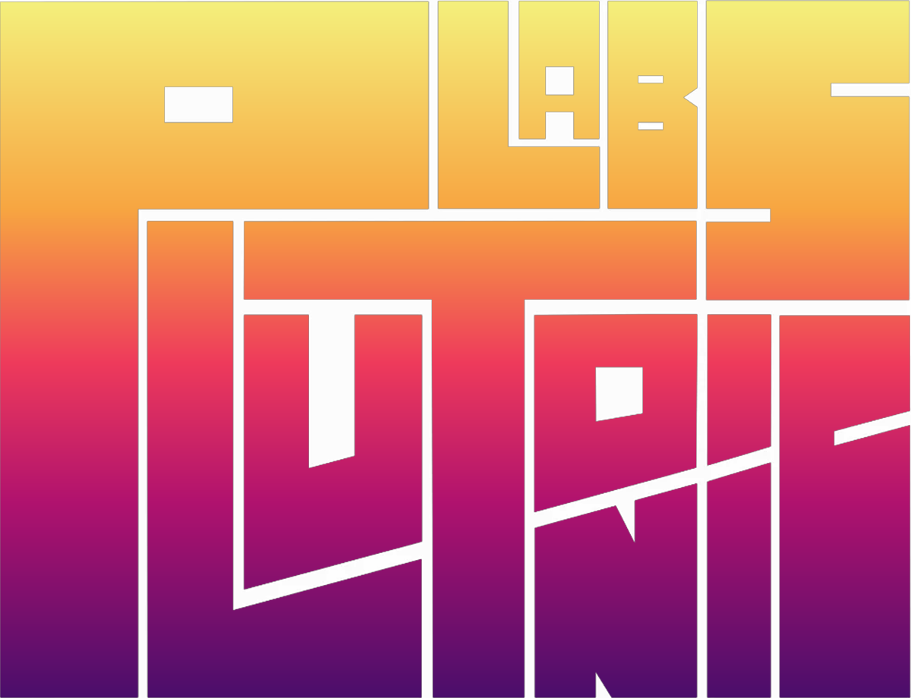
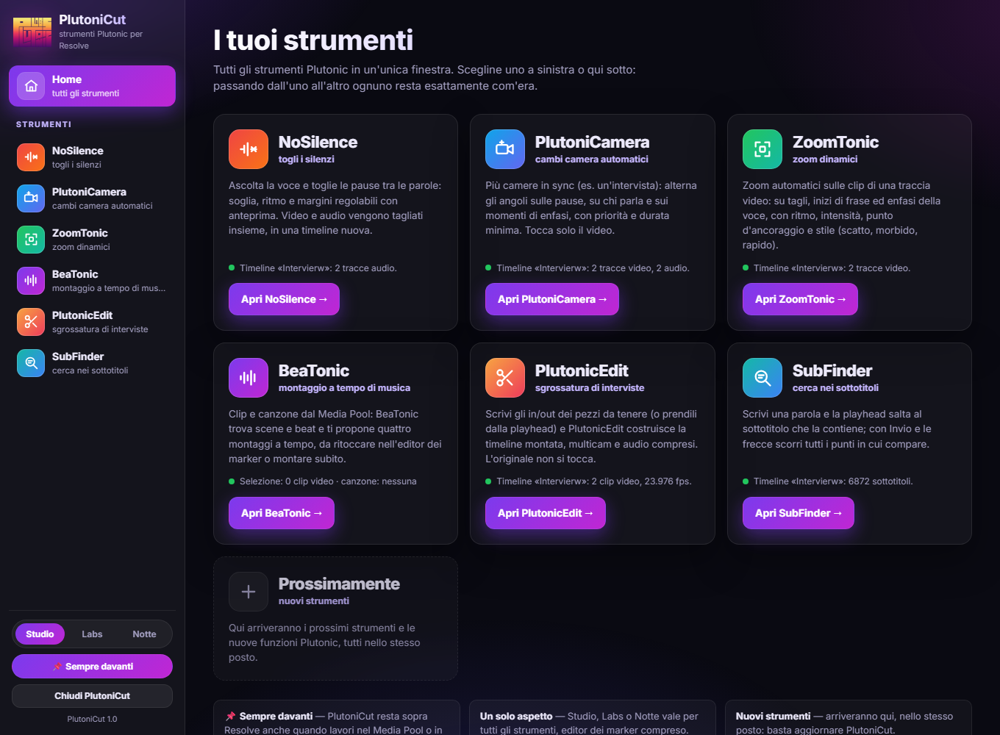
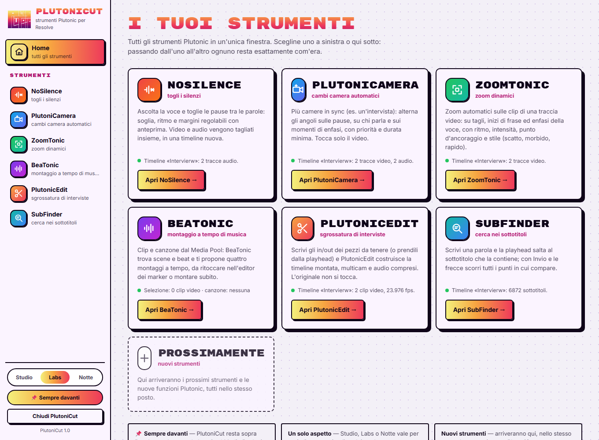
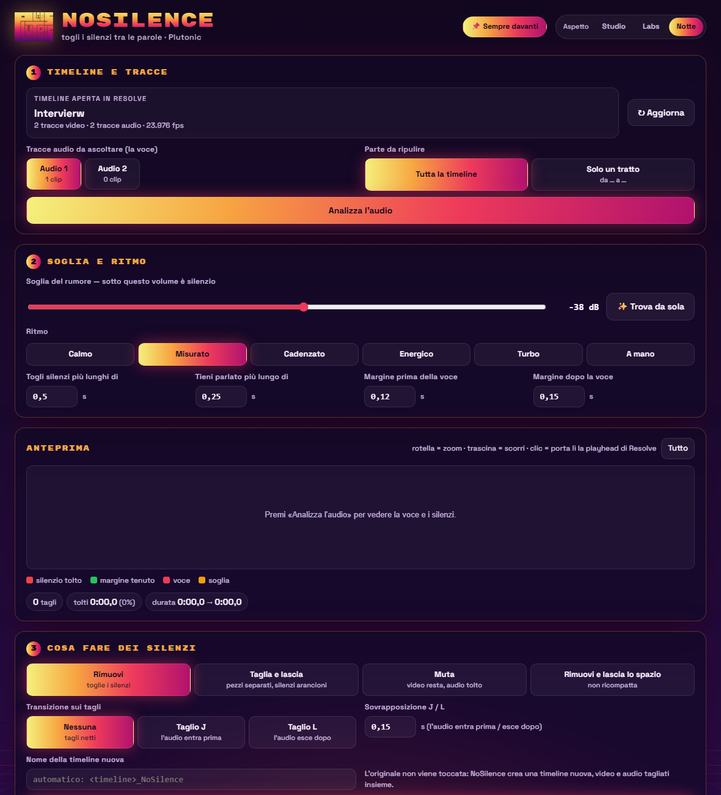
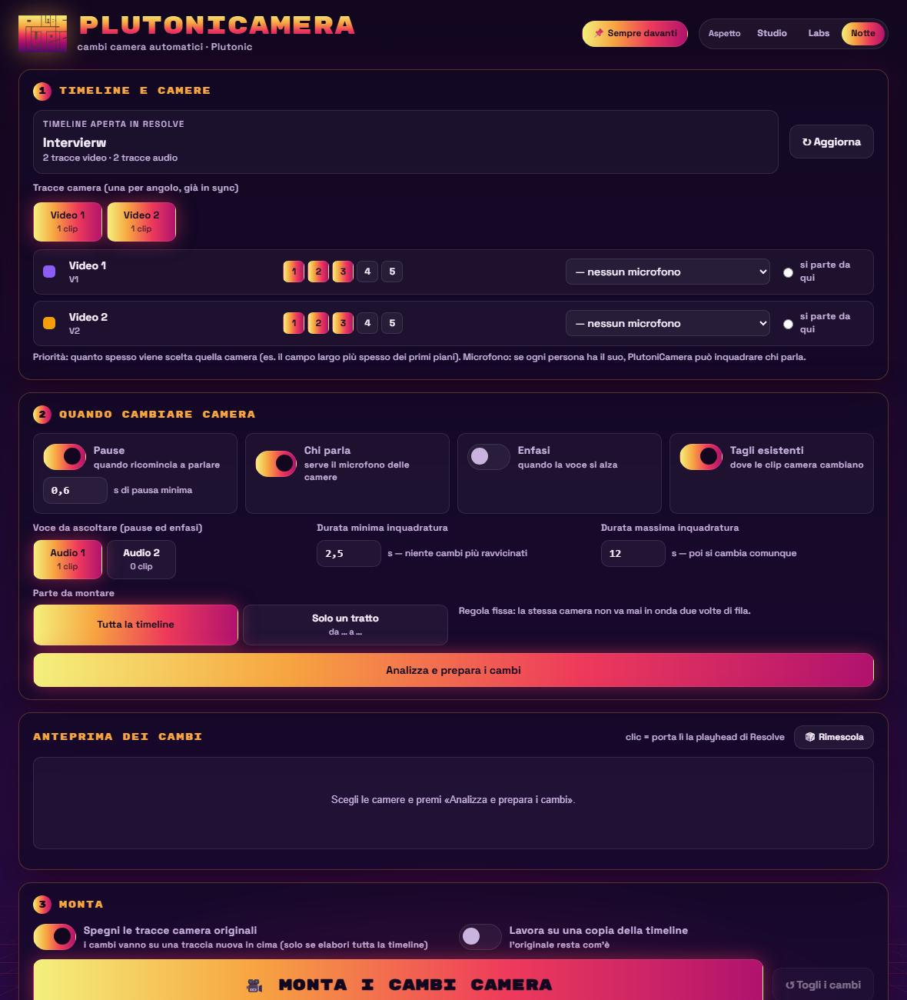
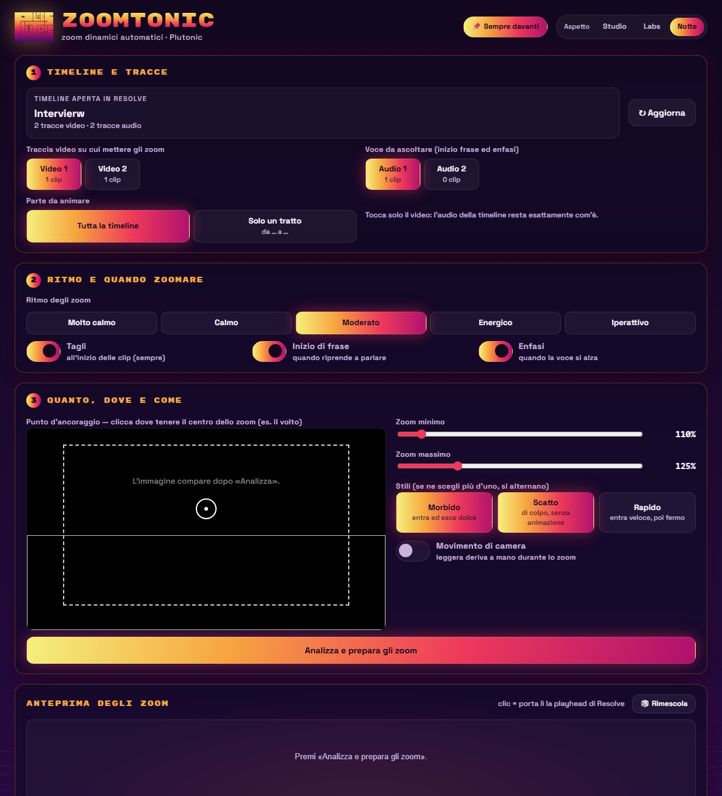

  

<h1 align="center">PlutoniCut</h1>

<em>La casa degli strumenti Plutonic per DaVinci Resolve: tutti in un'unica finestra.</em>

  
  
  
  

---

## Cos'è

**PlutoniCut** è un unico plugin che raccoglie tutti gli strumenti Plutonic, come AutoCut:
a sinistra l'elenco, a destra lo strumento aperto. Si passa dall'uno all'altro senza
perdere niente: ognuno resta esattamente com'era.

| Strumento | Cosa fa |
|---|---|
| **NoSilence** | toglie i silenzi tra le parole: video e audio tagliati insieme, in una timeline nuova |
| **PlutoniCamera** | cambi camera automatici tra più camere in sync (pause, chi parla, enfasi); tocca solo il video |
| **ZoomTonic** | zoom dinamici automatici sulle clip di una traccia video; tocca solo il video |
| **[BeaTonic](https://github.com/blueMeth-vfx/BeaTonic)** | monta in automatico le clip a tempo di musica: quattro montaggi pronti, editor dei marker, canzone adattata alla durata |
| **[PlutonicEdit](https://github.com/blueMeth-vfx/PlutonicEdit)** | sgrossa le interviste: tieni solo gli in/out che scrivi (o prendi dalla playhead), multicam e audio compresi, l'originale non si tocca |
| **[SubFinder](https://github.com/blueMeth-vfx/SubFinder)** | cerca una parola nei sottotitoli e porta lì la playhead |

- **Scheda iniziale**: la prima volta che apri uno strumento, poche righe su cosa fa e come
  si usa (si può non mostrare più; **ⓘ Come si usa** la riapre).
- **Un solo aspetto** (Studio, Labs, Notte) per tutti gli strumenti, editor dei marker compreso.
- **📌 Sempre davanti**: resta sopra Resolve anche quando clicchi nel Media Pool o in timeline.
- Lo stato di ogni strumento si vede nella barra a sinistra (al lavoro, errori).

| Studio | Labs | Notte |
|---|---|---|
|  |  |  |

---

## I nuovi strumenti

### NoSilence — togli i silenzi
- **Tracce audio** da ascoltare (la voce) e parte da ripulire (tutta o da/a con la playhead).
- **Soglia del rumore** in dB, con **✨ Trova da sola** (stima dal rumore di fondo e dalla voce).
- **Ritmo**: Calmo, Misurato, Cadenzato, Energico, Turbo, oppure a mano: *togli silenzi più lunghi
  di*, *tieni parlato più lungo di*, *margine prima* e *dopo* la voce.
- **Anteprima**: la voce, la soglia, in rosso i silenzi tolti e in verde i margini; rotella = zoom,
  clic = porta lì la playhead di Resolve; tagli, tempo tolto e durata finale.
- **Cosa fare dei silenzi**: rimuovi · taglia e lascia (silenzi arancioni) · muta (video resta,
  audio tolto) · rimuovi lasciando lo spazio. **Tagli J / L** con sovrapposizione regolabile.
- Il risultato è una **timeline nuova**: video e audio tagliati insieme e allineati al fotogramma
  (anche clip a frame rate diverso dalla timeline). L'originale non si tocca.

### PlutoniCamera — cambi camera automatici
- **Tracce camera** (una per angolo, già in sync), ognuna con **priorità** da 1 a 5, il
  **microfono** della persona inquadrata (se c'è) e la camera da cui partire.
- **Quando cambiare**: alle **pause** (quando riprende a parlare), su **chi parla** (coi microfoni),
  sull'**enfasi** della voce, sui **tagli esistenti**. **Durata minima** e **massima** dell'inquadratura;
  la stessa camera non va **mai** in onda due volte di fila.
- **Anteprima** a colori di quale camera va in onda e quando, con la percentuale di tempo per
  camera; **🎲 Rimescola** per un'altra scelta con le stesse regole.
- I cambi vanno su una **traccia video nuova «PlutoniCamera» in cima** (grade e trasformazioni delle
  clip copiati); si possono **spegnere le tracce camera originali** e lavorare su una **copia** della
  timeline. **L'audio non si tocca.** **↺ Togli i cambi** torna indietro.

### ZoomTonic — zoom dinamici
- **Traccia video** su cui zoomare e **voce** da ascoltare.
- **Ritmo**: Molto calmo, Calmo, Moderato, Energico, Iperattivo. **Quando**: sui **tagli** (sempre),
  all'**inizio delle frasi**, nei momenti di **enfasi**.
- **Zoom minimo e massimo**, **punto d'ancoraggio** cliccato su un fotogramma vero della clip,
  **stili** Morbido (entra ed esce dolce), Scatto (di colpo), Rapido (entra veloce e resta),
  combinabili; **movimento di camera** leggero durante lo zoom (mai oltre il bordo dell'immagine).
- Gli zoom vanno in una **composizione Fusion «ZoomTonic»** su ogni clip: si possono ritoccare
  nella pagina Fusion e **↺ Togli gli zoom** li rimuove tutti. Solo il video cambia, l'audio no.
  Le clip che hanno già una loro composizione Fusion vengono saltate.

> Ordine consigliato: **NoSilence → PlutoniCamera → ZoomTonic**.

---

## Requisiti

- **DaVinci Resolve Studio** (lo scripting non è disponibile nella versione gratuita).
- **Google Chrome** o **Microsoft Edge** per la finestra (su Windows Edge c'è sempre).
- **ffmpeg** (es. in `C:\ffmpeg\bin`) per BeaTonic, NoSilence, PlutoniCamera e ZoomTonic: serve ad
  ascoltare l'audio e a leggere le immagini.
- **Nessuna** dipendenza Python esterna: Python interno di Resolve.

---

## Installazione

1. **Scarica** questo repository: **Code ▸ Download ZIP**, poi estrai.
2. Apri la cartella degli script **Utility** di Resolve:
   - **Windows:** `%APPDATA%\Blackmagic Design\DaVinci Resolve\Support\Fusion\Scripts\Utility`
   - **macOS:** `~/Library/Application Support/Blackmagic Design/DaVinci Resolve/Fusion/Scripts/Utility`
3. Copia lì dentro i due file di `resolve_scripts/`: **`PlutoniCut.py`** e **`plutonic_logo.png`**.
4. Riavvia Resolve e apri **Workspace ▸ Scripts ▸ Utility ▸ PlutoniCut**.

Un solo file contiene tutti gli strumenti: non servono BeaTonic.py, SubFinder.py ecc. a parte.

---

## Per chi sviluppa

Gli strumenti restano progetti separati (ognuno funziona anche da solo):
[BeaTonic](https://github.com/blueMeth-vfx/BeaTonic), [PlutonicEdit](https://github.com/blueMeth-vfx/PlutonicEdit), [SubFinder](https://github.com/blueMeth-vfx/SubFinder).
`build.py` li prende dalle loro cartelle e li include, compressi, in `resolve_scripts/PlutoniCut.py`
insieme alla casa (`src/hub_tpl.py` + `src/hub.html`). NoSilence, PlutoniCamera e ZoomTonic vivono
qui: sorgenti in `src/tools/`, parti comuni in `src/common/` (finestra, livello audio, pezzi di clip,
ricostruzione della timeline); `build.py` crea anche `strumenti/<Nome>.py`, che funzionano da soli.

- **Aggiungere uno strumento**: una voce in `TOOLS` di `build.py` (nome, colore, descrizione,
  testi della scheda iniziale, file). Lo strumento deve avere `setup()`, `CMDS`, `STATE`,
  `start_server()` e la pagina con la modalità `?embed`, come gli altri.
- Ogni strumento gira nel suo spazio di nomi col suo piccolo server su `127.0.0.1`; la casa lo
  mostra al suo interno ed esegue i comandi di tutti, uno alla volta (l'API di Resolve è una sola).

---

## Licenza

Software proprietario — © Matteo Congedo / Plutonic Studio. Tutti i diritti riservati.
Vedi [LICENSE](LICENSE).
