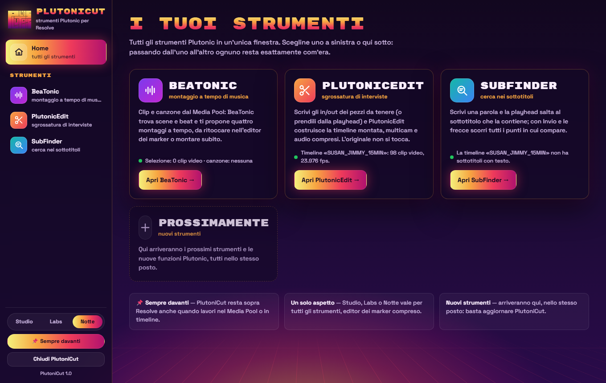

  

<h1 align="center">PlutoniCut</h1>

<em>La casa degli strumenti Plutonic per DaVinci Resolve: tutti in un'unica finestra.</em>

  
  
  
  

---

## Cos'è

**PlutoniCut** è un unico plugin che raccoglie tutti gli strumenti Plutonic, come AutoCut:
a sinistra l'elenco, a destra lo strumento aperto. Si passa dall'uno all'altro senza
perdere niente: ognuno resta esattamente com'era.

| Strumento | Cosa fa |
|---|---|
| **[BeaTonic](https://github.com/blueMeth-vfx/BeaTonic)** | monta in automatico le clip a tempo di musica: quattro montaggi pronti, editor dei marker, canzone adattata alla durata |
| **[PlutonicEdit](https://github.com/blueMeth-vfx/PlutoniEdit)** | sgrossa le interviste: tieni solo gli in/out che scrivi (o prendi dalla playhead), multicam e audio compresi, l'originale non si tocca |
| **[SubFinder](https://github.com/blueMeth-vfx/SubFinder)** | cerca una parola nei sottotitoli e porta lì la playhead |

- **Scheda iniziale**: la prima volta che apri uno strumento, poche righe su cosa fa e come
  si usa (si può non mostrare più; **ⓘ Come si usa** la riapre).
- **Un solo aspetto** (Studio, Labs, Notte) per tutti gli strumenti, editor dei marker compreso.
- **📌 Sempre davanti**: resta sopra Resolve anche quando clicchi nel Media Pool o in timeline.
- Lo stato di ogni strumento si vede nella barra a sinistra (al lavoro, errori).

| Studio | Labs | Notte |
|---|---|---|
|  |  |  |

---

## Requisiti

- **DaVinci Resolve Studio** (lo scripting non è disponibile nella versione gratuita).
- **Google Chrome** o **Microsoft Edge** per la finestra (su Windows Edge c'è sempre).
- **ffmpeg** per BeaTonic (analisi di scene e beat).
- **Nessuna** dipendenza Python esterna: Python interno di Resolve.

---

## Installazione

1. **Scarica** questo repository: **Code ▸ Download ZIP**, poi estrai.
2. Apri la cartella degli script **Utility** di Resolve:
   - **Windows:** `%APPDATA%\Blackmagic Design\DaVinci Resolve\Support\Fusion\Scripts\Utility`
   - **macOS:** `~/Library/Application Support/Blackmagic Design/DaVinci Resolve/Fusion/Scripts/Utility`
3. Copia lì dentro i due file di `resolve_scripts/`: **`PlutoniCut.py`** e **`plutonic_logo.png`**.
4. Riavvia Resolve e apri **Workspace ▸ Scripts ▸ Utility ▸ PlutoniCut**.

Un solo file contiene tutti gli strumenti: non servono BeaTonic.py, SubFinder.py ecc. a parte.

---

## Per chi sviluppa

Gli strumenti restano progetti separati (ognuno funziona anche da solo):
[BeaTonic](https://github.com/blueMeth-vfx/BeaTonic), [PlutonicEdit](https://github.com/blueMeth-vfx/PlutoniEdit), [SubFinder](https://github.com/blueMeth-vfx/SubFinder).
`build.py` li prende dalle loro cartelle e li include, compressi, in `resolve_scripts/PlutoniCut.py`
insieme alla casa (`src/hub_tpl.py` + `src/hub.html`).

- **Aggiungere uno strumento**: una voce in `TOOLS` di `build.py` (nome, colore, descrizione,
  testi della scheda iniziale, file). Lo strumento deve avere `setup()`, `CMDS`, `STATE`,
  `start_server()` e la pagina con la modalità `?embed`, come gli altri.
- Ogni strumento gira nel suo spazio di nomi col suo piccolo server su `127.0.0.1`; la casa lo
  mostra al suo interno ed esegue i comandi di tutti, uno alla volta (l'API di Resolve è una sola).

---

## Licenza

Software proprietario — © Matteo Congedo / Plutonic Studio. Tutti i diritti riservati.
Vedi [LICENSE](LICENSE).
